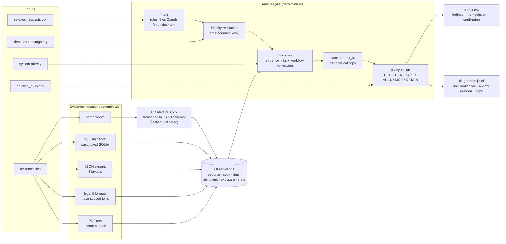

# Ghost Data Deletion Audit Agent

[](https://github.com/hirishikesh/ghost-data-deletion-audit-agent/actions/workflows/tests.yml)

An auditor for "right to erasure" requests. A deletion workflow may say **Complete** while
the person's data still sits in a failover replica, a search index, a support attachment, an
export, or a backup that can restore it. This system reads the evidence those systems leave
behind - SQL snapshots, JSON exports, six log formats, PDFs and admin-console screenshots -
works out what was actually true at the audit time, applies the deletion policy, and returns
an ordered, evidence-cited plan: what is still there, what to disable, block, delete, redact
or anonymise, and what to verify afterwards.

Built for **HackerRank Orchestrate (October 2026) - "Ghost Data Still Exists"**, then
hardened after the competition.

## Competition result

**Rank #192 of 4,094 participants (top 4.7%)** - total 73.2 / 100.

| Component | Score |
|---|---:|
| AI development transcript | 8.4 / 10 |
| AI Judge interview | 22.5 / 30 |
| Output CSV (hidden test set) | 27.9 / 30 |
| Code ZIP | 14.4 / 30 |

The judged code is preserved unchanged, with the full development history, in a private
archive repository (tag `hackerrank-submission-v1`); it is not public because it contains
HackerRank's unlicensed starter material and identifiers from the challenge evidence. The
project-written parts of the submission are in [docs/submission-v1](docs/submission-v1/).
Everything else here was written after the competition and is described in
[docs/post-competition-fixes.md](docs/post-competition-fixes.md). The score breakdown does not
say why points were deducted, so no fix here is claimed to address a specific deduction.

## Architecture



### Why deterministic code makes the compliance decisions

A deletion verdict has to be reproducible, explainable record by record, and open to audit.
So every decision - who the person is, which records are theirs, what state each copy was in
at `audit_at`, what the policy requires, and the order of the plan - is plain Python.
Deterministic does not mean correct: it means the same input always gives the same answer
and every step can be traced to evidence, so mistakes can be found, reproduced and fixed.
The rules themselves can still be wrong, which is why they carry regression tests and are
checked against the labelled samples. The model is used in exactly two places where code
cannot do the job:

1. **Screenshots** of admin consoles are transcribed by Claude Opus 5.5 into a fixed JSON
   schema (structured output). The model only transcribes; the code validates every value
   and decides what it means.
2. **Request intent** - "is this person actually asking for deletion?" - is settled by
   multilingual keyword rules for clear cases. Only texts with mixed or missing signals go to
   the model, inside the user message, with a fixed system prompt and a schema-checked answer.

The full 518-request run needs 11 screenshot transcriptions and 9 intent calls; recorded
development spend, including a connectivity check and 9 calls with an earlier prompt, was 30
calls ($0.41). This is better described as
a **constrained audit pipeline** than an autonomous multi-agent system, and that is the point:
the model never makes the compliance decision. It supplies transcribed facts that code
validates and applies - which also means a misread screenshot value can still mislead a
verdict (see [Remaining limitations](#remaining-limitations)).

### How evidence is ingested and verified

Every source becomes `Observation` records: which resource, which physical **copy** (primary
or a named replica), when it was observed, which identifiers tie it to a person, which direct
identifiers are still exposed, and any state (present, enabled, restore allowed, retention).

- **SQL snapshots** run in an in-memory SQLite database under an authorizer that refuses
  `ATTACH`, so evidence cannot write to disk. Primary, regional, reporting and failover
  tables stay separate copies. A row marked `DELETED` that still holds an email is still a
  remaining record.
- **Logs** in six formats are normalised; a lookup key is joined to its result only inside a
  one-lookup trace, so a reused trace id cannot link two customers.
- **PDFs** link identifiers to the record on the same line when several records appear;
  a record named next to "deleted" or "removed" is a mention, not proof of presence.
- **Workflow claims** (`reported_status`, worker results) are never treated as proof of
  state. Evidence decides.
- **Unreadable evidence** (missing key, API failure, corrupt file, path outside the dataset)
  is recorded as a gap and blocks a `COMPLETE` verdict for requests whose window it falls in.

### Identity resolution and temporal reconstruction

Identity uses exact identifiers, not embeddings: every email, phone, email hash (SHA-256 of
each email ever used) and user id, each with the interval it was valid, rebuilt from the
change log. A request email resolves to whoever held it at `requested_at`; if that is more
than one person the result is `ambiguous`, never the first id in sorted order. Only
identifiers owned by a single person link records.

State is reconstructed from evidence captured at or before `audit_at` only. Each physical copy
keeps its own latest observation, so a newer "not found" on the primary cannot hide a
replica that still holds the profile. A record counts as gone only when every copy is.

Some links are correlations, not proof - for example a deletion-worker event whose timing
and result match the request. Each linked record carries its kind (`evidence`,
`workflow_unique`, `workflow_tie`, `analytics_unique`, `analytics_tie`) in the diagnostics,
destructive steps on tied links are flagged for review, and `--production-safe` drops them.

## Evaluation

Public labelled samples (32) - these are development measurements, **not** hidden-test scores:

| Metric | Submission | v2 |
|---|---:|---:|
| Status accuracy | 1.000 | 1.000 |
| Step precision / recall | 0.995 / 0.964 | 0.995 / 0.964 |
| Step F1 | 0.979 | 0.979 |
| Field accuracy | 0.947 | 0.947 |
| Exact ordered sequence | 0.781 (25/32) | 0.781 (25/32) |

With all evidence readable, v2 produces the same output as the submission on all 518
challenge requests and all 32 samples - the fixes change behaviour only where evidence is
missing, ambiguous or hostile:

| Robustness check | Submission | v2 |
|---|---|---|
| Offline (no key, no cache): `COMPLETE` rows with no verification steps | 6 | 0 |
| Unresolvable or ambiguous email | `COMPLETE`, no steps | `INCOMPLETE` + review reason |
| Evidence SQL containing `ATTACH DATABASE` | writes a file to disk | blocked, recorded as gap |
| API error after retries | run aborts | evidence marked unread, run continues |
| Automated tests | none | 35 regression tests |

**Limitations of these numbers.** 32 samples is small; several labelled records exist in no
participant file, which caps recall; and the sample set contains none of the adversarial
situations the v2 fixes target, so the robustness gains are shown by the synthetic tests,
not by these metrics.

## Quick start

```bash
pip install -r requirements-dev.txt        # or: pip install -e ".[dev]"
python -m pytest                           # 34 synthetic tests (+1 that needs the private data)
python examples/build_demo.py              # five fictional customers, five situations
python -m ghost_audit --dataset examples/demo_dataset --offline \
    --cache-dir examples/.demo_cache --output examples/demo_output.csv
```

The demo needs no key. One of its cases is the "ghost data" situation: the service lookup
says the account is gone, but the failover replica captured the day before still holds the
full profile.

```text
case_2 INCOMPLETE
   1. FINDING      REPORT_REMAINING_RECORD   account_2   evidence_02
   2. REMEDIATION  DELETE_RECORD             account_2
   3. VERIFICATION VERIFY_RECORD_ABSENT      account_2
case_3 INCOMPLETE
   ... REPORT_ACTIVE_DATA_FLOW, REPORT_RESTORE_RISK
   ... DISABLE_DATA_FLOW and BLOCK_RESTORE before DELETE_RECORD
```

### Running on the challenge data

The HackerRank dataset is private and is not in this repository. With a local copy:

```bash
cp .env.example .env                       # add ANTHROPIC_API_KEY (screenshots, unclear intents)
python -m ghost_audit --dataset /path/to/dataset --output output.csv
python evaluation/run_all.py --dataset /path/to/dataset
GHOST_AUDIT_DATASET=/path/to/dataset python -m pytest
```

**Reproducing the published numbers needs the screenshots read.** The first run with
`ANTHROPIC_API_KEY` set reads the 11 screenshots and the unclear request texts (about
$0.40) and caches every answer in `.cache/`; after that, runs are free and identical. Checked
from a fresh clone: with the cache, the sample metrics match the table above and
`output.csv` is byte-identical to the submitted one. Without a key or cache the auditor is
deliberately conservative - any request whose window contains an unread screenshot is
flagged rather than marked complete - so the samples score lower (status accuracy 0.688,
step F1 0.821) and the private-sample test skips with that explanation.

Useful flags: `--offline` (no model calls; unread screenshots are reported, never assumed),
`--strict` (exit 2 if any evidence could not be read), `--production-safe`, and
`AUDIT_BUDGET_USD` (hard spend cap, default $3). `.cache/` is git-ignored because it holds
transcriptions of the evidence.

## Project layout

```text
ghost_audit/        model, evidence parsers, identity, intent, vision, llm client, engine, cli
ghost_audit/prompts the two prompts (screenshot transcription, request intent)
evaluation/         sample scorer, custom cases, usage report
tests/              synthetic dataset builder + regression tests
examples/           synthetic demo builder
docs/               post-competition fix log, roadmap, submitted reports (docs/submission-v1)
```

## Remaining limitations

- **111 workflow-correlated accounts are ties** (55 groups): each is an account the request's
  own workflow processed, but which one cannot be proven from the data. Labelled `workflow_tie`.
- **60 anonymised analytics profiles are left unassigned** rather than guessed.
- **Known fail-open paths remain** - for example the offline intent fallback and
  "absence by omission" from filtered snapshots. They are listed with planned corrections in
  [docs/responsible-ai.md](docs/responsible-ai.md#5-remaining-fail-open-behaviour).
- **Not production-ready**: a batch auditor over exported evidence with no live connectors,
  authentication, approval trail or monitoring, evaluated on 32 labelled samples.

See [docs/roadmap.md](docs/roadmap.md) for what comes next.

## How this project was built: human-AI collaboration

This is human-directed, AI-assisted engineering. Most of the implementation was generated
with AI tools; the decisions about what to build, what to trust and what to submit were mine.

| | Role |
|---|---|
| **Me** | Defined the objective and priorities, directed the development, reviewed progress, challenged assumptions and asked for deeper investigation, used independent reviews to look for weaknesses, chose correctness and explainability over maximising the public-sample score, and took responsibility for evaluating and submitting the solution. |
| **Claude Code** (Claude Opus 5.5) | Primary implementation tool: wrote the Python modules, evidence parsers, evaluation scripts and the model integration; ran the debugging, experiments and iterations; built the reproducible evaluation workflow, and after the competition the fixes, tests and documentation in this repository. |
| **ChatGPT** | Independent technical reviewer and reasoning partner: examined implementation decisions and reported evaluation findings; flagged possible weaknesses in identity resolution, evidence provenance, replicas, PDF parsing and uncertainty; helped shape targeted test and fix requests; supported my understanding of the system and AI Judge interview preparation. |

**No AI output was treated as proof of correctness - including the reviews.** Findings were
checked against the code, tests and evidence before anything changed:

- The independent review listed about nine suspected weaknesses. Reproducing each against the
  tagged submission showed one that the challenge data itself triggers (missing evidence read
  as success, in an offline run) and one security flaw reproduced with a crafted file
  (evidence SQL able to write to disk). The rest were real code paths the data never
  exercised, so each was proven with a synthetic test before it was fixed.
- Where I pushed back on "this cannot be found", the investigation found the strongest
  signal in the project: the deletion worker's result matches the request's reported status
  in 223 of 224 evidence-linked cases, which linked 163 more accounts without guessing.
- Verification also caught the AI's own mistakes: the labelled-sample test caught a
  regression introduced while making state replica-aware (`case_24`), and CI caught a Python
  3.10 incompatibility that no local run showed.

## Responsible AI design principles

Details, verification status for each safeguard, data-handling boundaries and open risks are
in **[docs/responsible-ai.md](docs/responsible-ai.md)**.

1. **AI where useful, deterministic engineering where necessary.** Claude Opus 5.5 transcribes
   screenshots and classifies request text the rules cannot settle (9 of 550). Identity
   matching, time checks, policy and output are Python. That makes those decisions
   reproducible and auditable - the same input gives the same answer, traceable to evidence -
   though not automatically correct, so they are covered by tests rather than trusted.
2. **Evidence over confidence.** A worker "success" is a claim. A record counts as gone only
   when evidence captured before `audit_at` shows every copy gone.
3. **Uncertainty is stated, not resolved by guessing.** The 111 tied accounts are labelled as
   correlations, not proof; a model cannot recover identity information the evidence does not
   contain. Destructive steps on them are flagged, and a production system should escalate
   such ownership to a person.
4. **Privacy by design.** Only screenshots and unclear request texts reach the model;
   diagnostics hold internal ids, never emails, phones or names (tested); the dataset, key,
   cache and traces never enter the repository. Unredacted screenshots and a plain-text local
   cache are open items.
5. **Human oversight.** The system writes findings and a plan; it cannot act on live systems.
   Real deletions need explicit authorization, a record of who approved them, and a re-audit.
6. **Safe failure.** API errors, refusals, unreadable files and ambiguous identities become
   review reasons instead of a confident `COMPLETE`. Remaining fail-open paths are documented,
   not hidden.
7. **Narrow prompts, validated output.** Fixed system prompts, inputs passed as data,
   structured JSON, then deterministic validation. Structured output constrains the shape;
   it does not stop a misread value or a manipulated answer, which is why the model's role is
   kept small.
8. **Evaluation integrity.** A development version scored **0.987** sample step F1 while
   assigning some analytics profiles to two people; enforcing one owner per profile lowered it
   to **0.979** and removed every known invalid assignment. Public-sample metrics are reported
   separately from the competition score.

## What this project taught me about building responsible AI systems

- **AI-generated code still needs testing and independent scrutiny.** Claude Code wrote most of
  this system quickly, and it also introduced bugs that only a test suite and CI exposed. The
  speed is real; so is the need to check.
- **A fluent answer is not a correct answer.** A confident review read like a list of defects;
  reproducing it showed most were latent. A confident "deleted" from a workflow was often
  wrong. Both had to be verified against evidence.
- **Missing evidence is not proof of success.** The submitted version, run without its model
  cache, reported six deletions as complete with nothing to show for it. Silence from a data
  source has to be reported as silence.
- **Metrics matter, but they do not replace judgment.** Taking the lower sample score to keep
  a correctness invariant was the right call, and I can explain why.
- **Accountability stays with the human.** The AI generated most of the implementation; the
  responsibility for what was claimed, submitted and published is mine.

## License

The code and documentation written for this project are released under the
[MIT License](LICENSE). The challenge itself - its name, task description, data and the
Orchestrate starter repository - belongs to HackerRank and is not covered by this license;
none of the challenge dataset or evidence is included here, and the starter repository's
instructions are omitted from [docs/submission-v1](docs/submission-v1/README.md).
